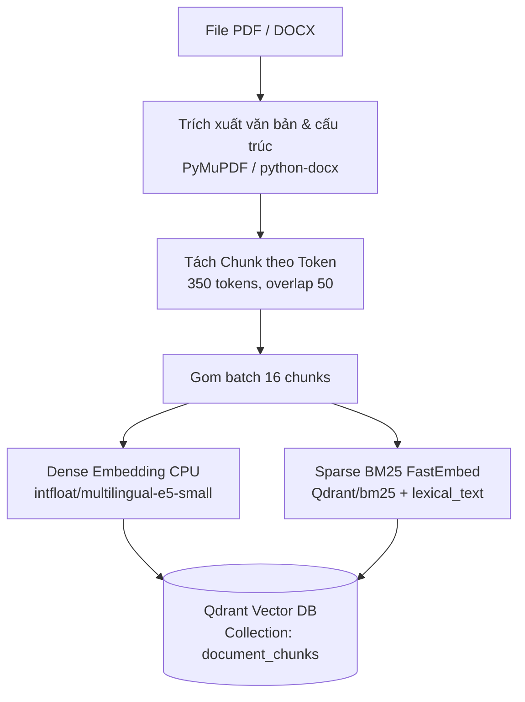

# Module 2: RAG Service — CMS Edu

Dịch vụ RAG (Retrieval-Augmented Generation) tra cứu và giải thích tài liệu nội bộ, tự động sinh chuẩn đầu ra (CLO) và ma trận Rubric đánh giá năng lực cho hệ thống CMS Edu.

---

## 1. Vị trí trong Hệ thống
- **Backend .NET (Core API)**: Quản lý người dùng, lớp học, tài liệu nghiệp vụ; xác thực người dùng và phát hành Bearer Token (JWT).
- **Module 2 RAG (FastAPI Service)**: Nhận yêu cầu từ Core API hoặc Frontend qua JWT (`HS256`, dùng chung secret). Thực thi trích xuất tài liệu, lưu trữ vector đa chiều trong Qdrant, tìm kiếm lai (Hybrid Search) và gọi Google Gemini với Structured Outputs.

---

## 2. Khởi chạy nhanh

### Yêu cầu
- Python 3.12+
- Docker & Docker Compose (cho Qdrant)

### Các bước cài đặt
1. **Khởi động Qdrant Vector Database**:
   ```bash
   docker compose up -d qdrant
   ```
2. **Cấu hình môi trường (`.env`)**:
   Tạo file `.env` tại thư mục gốc của module:
   ```env
   RAG_JWT_ISSUER=CmsEdu.Api
   RAG_JWT_AUDIENCE=CmsEdu.Web
   RAG_JWT_SECRET=your_jwt_secret_at_least_32_bytes_long
   RAG_GEMINI_API_KEY=your_gemini_api_key
   ```
   *(Các biến tùy chọn: `RAG_QDRANT_URL=http://localhost:6333`, `RAG_QDRANT_COLLECTION_NAME=document_chunks`, `RAG_STORAGE_ROOT=storage`)*

3. **Cài đặt thư viện**:
   ```bash
   pip install -e .
   ```

4. **Nạp dữ liệu mẫu (Ingestion CLI)**:
   Đặt các file `.pdf` hoặc `.docx` vào `data/raw/` rồi chạy:
   ```bash
   python scripts/ingest.py
   ```

5. **Khởi chạy API Server**:
   ```bash
   uvicorn main:app --host 0.0.0.0 --port 8000 --reload
   ```
   Tài liệu Swagger UI có sẵn tại: `http://localhost:8000/docs`

---

## 3. Kiến trúc Luồng Dữ liệu (Pipelines)

### 3.1. Luồng Nạp Tài Liệu (Document Ingestion)


### 3.2. Luồng Truy Vấn & Sinh Nội Dung (Retrieval & Generation)
```mermaid
flowchart TD
    Query[Câu hỏi của người dùng] --> EmbedQuery[Embed Dense 'query: ...'\n+ Sparse Query]
    EmbedQuery --> Prefetch[Qdrant Hybrid Search\nPrefetch Dense: 30 | Prefetch Sparse: 30]
    Prefetch --> RRF[Reciprocal Rank Fusion k=60\nChọn Top 15 ứng viên]
    RRF --> Rerank[Cross-Encoder Reranker\nmmarco-mMiniLMv2-L12-H384-v1\nChọn Top 4]
    Rerank --> Context[Ghép Context có đánh số nguồn\n[Nguồn 1: ...]]
    Context --> Gemini[Google Gemini 3.5 Flash\nStructured Outputs JSON]
    Gemini --> Validate[Pydantic Validation & Trích dẫn Nguồn]
```

---

## 4. Cấu trúc Thư mục

```text
src/
├── api/                  # Tầng giao diện REST API (FastAPI routes & schemas)
│   ├── chat.py           # Endpoint hỏi đáp notebook
│   ├── clo_rubric.py     # Endpoint sinh chuẩn đầu ra & xuất Excel
│   ├── documents.py      # Endpoints upload và xoá tài liệu/notebook
│   ├── schemas.py        # Pydantic request/response models
│   └── security.py       # Xác thực JWT Bearer token
├── core/                 # Cấu hình trung tâm & mô hình biểu diễn vector
│   ├── settings.py       # Pydantic BaseSettings (chỉ chứa hạ tầng & secret)
│   └── embeddings.py     # Dense (E5) + Sparse (BM25 FastEmbed)
├── ingestion/            # Tầng nạp & bóc tách tài liệu
│   ├── chunking.py       # Tách chunk theo token với binary search & overlap
│   ├── loaders/          # Bóc tách cấu trúc PDF (TOC, banner) & DOCX
│   └── pipeline.py       # Điều phối trích xuất, embedding và upsert vào Qdrant
├── retrieval/            # Tầng tìm kiếm & xếp hạng lại
│   ├── queries.py        # Qdrant Hybrid Query (Prefetch Dense+Sparse + RRF)
│   ├── reranker.py       # Cross-Encoder scoring & fallback
│   └── pipeline.py       # Điều phối search_notebook_context
├── generation/           # Tầng sinh nội dung LLM
│   ├── chat.py           # Logic sinh câu trả lời có căn cứ (Grounded Q&A)
│   ├── clo_rubric.py     # Logic sinh CLO & Rubric đa cấp độ Bloom
│   ├── gemini.py         # Client gọi Google Gemini SDK với Native Async
│   ├── prompts.py        # System prompt chống hallucination & prompt injection
│   └── xlsx_export.py    # Kết xuất bảng Rubric sang định dạng Excel (.xlsx)
├── storage/              # Tầng lưu trữ đĩa & kết nối Qdrant
│   ├── files.py          # Quản lý file upload & cấu trúc đường dẫn
│   └── qdrant.py         # Khởi tạo collection, payload index & client singleton
└── main.py               # Điểm khởi tạo FastAPI application & lifespan
```

---

## 5. Thiết kế Schema Qdrant

Toàn bộ tài liệu trong hệ thống được quản lý chung trong duy nhất **1 collection** tên là `document_chunks` theo mô hình Multi-tenancy:
- **Vectors**:
  - `dense`: 384 dimensions, Cosine distance (`intfloat/multilingual-e5-small`).
  - `sparse`: SparseVector, `modifier=Modifier.IDF` (`Qdrant/bm25`).
- **Payload Indexes**:
  - `notebook_id`: `UuidIndexParams(is_tenant=True)` — cô lập đồ thị HNSW theo từng notebook, đảm bảo multi-tenancy an toàn và hiệu năng.
  - `document_id`: `PayloadSchemaType.UUID` — phục vụ lọc theo tài liệu cụ thể.
  - `page_number`: `PayloadSchemaType.INTEGER` — phục vụ lọc chunk theo trang hiển thị.

---

## 6. Các Quyết định Thiết kế Kỹ thuật

| Quyết định | Giá trị / Giải pháp | Lý do kỹ thuật |
|---|---|---|
| **Chunk Size & Overlap** | 350 tokens, overlap 50 | Cặp `(Query + Metadata + Chunk)` gửi vào Cross-Encoder không vượt quá trần 512 tokens. 350 tokens ~ 200–250 từ tiếng Việt, bao trọn 1 hoạt động sư phạm. |
| **Embedding Prefixes** | `passage: ` và `query: ` | Mô hình `multilingual-e5-small` bất đối xứng bắt buộc tiền tố này để đạt độ tương đồng chính xác. |
| **BM25 Tiếng Việt** | `disable_stemmer=True` + `lexical_text` | Tránh stemmer tiếng Anh cắt cụt từ tiếng Việt; `lexical_text` bổ sung từ không dấu để tìm kiếm được cả khi gõ thiếu dấu. |
| **IdfCorpusParams** | `corpus=notebook` | Tính toán độ hiếm từ vựng (IDF) giới hạn trong phạm vi từng notebook, không bị sai lệch bởi tài liệu ở notebook khác. |
| **Funnel RRF & Rerank (Chat)** | Prefetch 30/30 $\to$ RRF 15 $\to$ Top 4 | Nhánh prefetch mở rộng (30) để High Recall; cắt 15 ứng viên qua RRF đưa vào Cross-Encoder CPU; chuyển Top 4 vào LLM để tra cứu chính xác. |
| **Grounded Answering & Out-of-Scope** | Gemini Structured Schema (`status`) | Thay vì ngắt sớm bằng ngưỡng logit cố định (dễ chặn nhầm câu hỏi thị giác), hệ thống để Gemini đánh giá bằng chứng và trả về `insufficient_evidence` hoặc `out_of_scope`. |
| **CLO & Rubric In-Context Scope** | Scroll Range (Tận dụng 1M Context Window) | Bỏ RAG mù mờ; lấy toàn bộ chunks theo phạm vi bài học hoặc toàn bộ sách, sắp xếp tuần tự theo `(page, chunk_index)` đưa thẳng vào Gemini sinh tối đa N CLO. |

---

## 7. Ràng buộc Bắt buộc Re-ingest
Khi thay đổi bất kỳ thành phần nào sau đây, bạn **bắt buộc phải xóa collection hoặc chạy lại nạp tài liệu**:
1. Đổi mô hình Embedding hoặc số chiều (`EMBEDDING_DIMENSION = 384`).
2. Đổi tiền tố embedding (`passage: ` / `query: `).
3. Đổi logic tách từ / bỏ dấu trong `lexical_text`.
4. Đổi kích thước `CHUNK_SIZE` hoặc `CHUNK_OVERLAP`.

---

## 8. Danh mục API Endpoints

| Phương thức | Endpoint | Mô tả |
|---|---|---|
| `POST` | `/api/v1/notebooks/{notebook_id}/documents/ingest` | Tải lên file PDF/DOCX và nạp vector vào Qdrant |
| `DELETE` | `/api/v1/notebooks/{notebook_id}/documents/{document_id}` | Xóa tài liệu và các chunk liên quan |
| `DELETE` | `/api/v1/notebooks/{notebook_id}` | Xóa toàn bộ dữ liệu của notebook |
| `POST` | `/api/v1/notebooks/{notebook_id}/chat` | Hỏi đáp ngữ cảnh tài liệu (kèm trích dẫn nguồn) |
| `POST` | `/api/v1/clo-rubric/generate` | Sinh chuẩn đầu ra CLO và tải file Excel Rubric |
| `GET` | `/health` | Kiểm tra trạng thái hoạt động dịch vụ |

---

## 9. Các Giới hạn Đã Biết
- **PDF Scan**: Hiện tài liệu PDF chỉ hỗ trợ trích xuất text số (vector PDF). Với file scan hoàn toàn là hình ảnh không có OCR layer, loader sẽ từ chối để tránh nạp dữ liệu rỗng.
- **Bố cục đặc thù**: Bóc tách mục lục và tiêu đề hoạt động được tối ưu cho cấu trúc sách chuyên đề toán tư duy CMS Edu (mục lục trang 3, banner 12% đầu trang).
